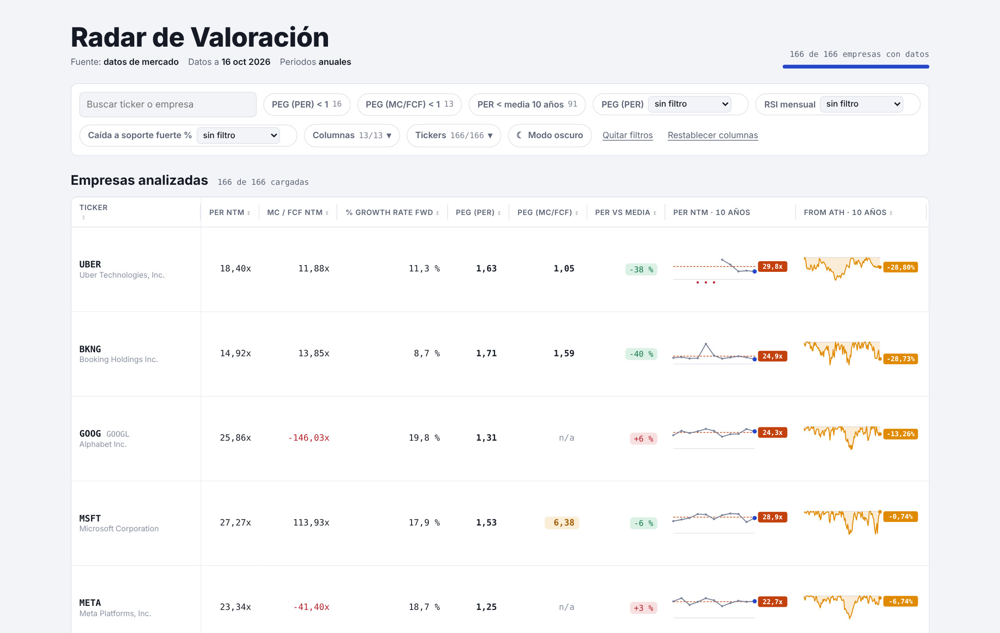
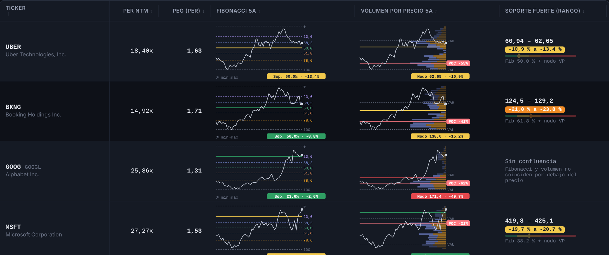
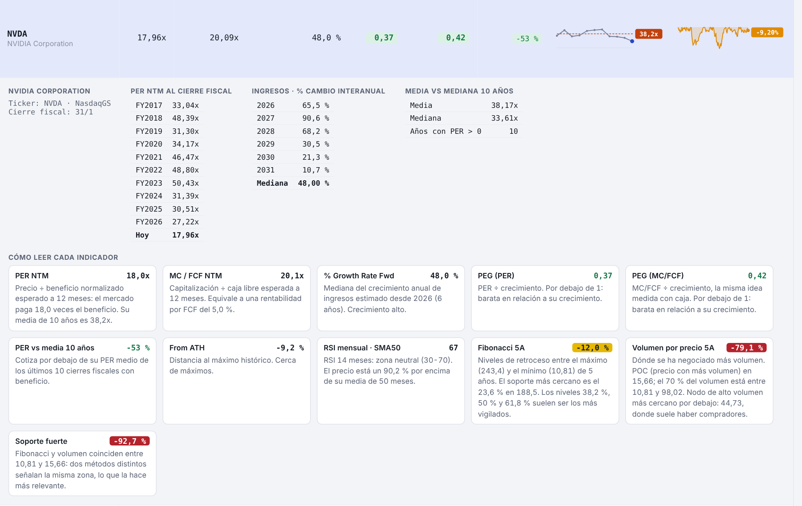
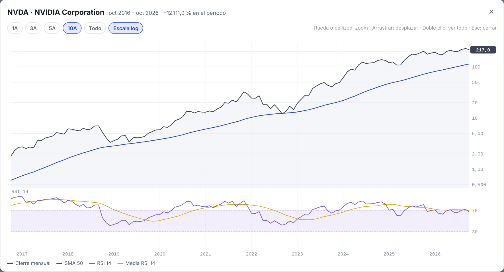

# Análisis de carteras de inversión · Radar de Valoración

Herramienta interactiva para **analizar y monitorizar una cartera de acciones y una lista de seguimiento** combinando valoración fundamental (múltiplos, crecimiento, PEG) con análisis técnico de soportes (Fibonacci, volumen por precio, RSI). Todo en una única página web, sin instalación ni servidor.

> 🤖 **Cómo trabajo:** defino el análisis desde el criterio financiero (qué métricas usar, cómo normalizarlas, qué umbrales tienen sentido y cómo validar los datos), utilizo **Claude (Anthropic)** como asistente para extraer los datos y programar la herramienta, y reviso cada cálculo contra la fuente original. El objetivo es demostrar que un perfil de finanzas puede construir herramientas de análisis de inversión propias, reproducibles y adaptadas a su proceso.

**▶️ [Abrir la demo interactiva](https://jangostoc.github.io/Analisis-carteras-inversion/)** (compañías y datos ficticios) · las capturas muestran la herramienta con datos reales.



---

## 📂 Contenido

| Proyecto | Qué demuestra | Herramientas |
|---|---|---|
| [Radar de Valoración](radar/) | Screening de **166 compañías** por valoración relativa y crecimiento, detección de zonas de soporte por **dos métodos independientes** y su confluencia, con filtros combinables y fichas explicativas por empresa. | HTML · JavaScript · SVG · Python |

---

## 📊 Qué mide

**Valoración y crecimiento** (datos anuales)

| Indicador | Definición |
|---|---|
| PER NTM | Precio ÷ beneficio normalizado esperado a 12 meses |
| MC / FCF NTM | Capitalización ÷ flujo de caja libre esperado a 12 meses |
| % Growth Rate Fwd | Mediana del crecimiento interanual de ingresos estimado desde 2026 |
| PEG (PER) · PEG (MC/FCF) | Múltiplo ÷ crecimiento. < 1 indica valoración baja respecto al crecimiento esperado |
| PER vs media 10 años | Posición del PER actual frente a su media histórica (solo años con beneficio) |
| From ATH | Distancia al máximo histórico, con la caída mes a mes de los últimos 10 años |

**Tendencia y soportes** (datos de mercado)

| Indicador | Definición |
|---|---|
| COTIZHIST (mensual) | Cotización mensual en escala logarítmica con SMA 50 y RSI 14; ampliable con zoom |
| Fibonacci 5A | Retrocesos 23,6 / 38,2 / 50 / 61,8 / 78,6 % entre el máximo y el mínimo de 5 años (velas semanales) |
| Volumen por precio 5A | Perfil de volumen por rango de precios (24 filas, área de valor 70 %, POC, VAH/VAL) y nodo de alto volumen más cercano por debajo del precio |
| Soporte fuerte (rango) | Zona donde **coinciden** un nivel de Fibonacci y un nodo de volumen (≤ 5 % de separación): dos métodos distintos apuntando al mismo nivel |

Las distancias a soporte se codifican por color: 🟢 hasta −10 % · 🟡 −10 a −20 % · 🟠 −20 a −30 % · 🔴 más de −30 %.



---

## 🧰 Funcionalidades

- **Filtros combinables:** PEG < 1, PER bajo su media, y rangos libres (≤, ≥, entre) para PEG, RSI y caída hasta el soporte fuerte.
- **Personalización de la vista:** mostrar/ocultar columnas y tickers (con buscador), reordenar columnas arrastrando, ajustar anchos y alto de cabecera, modo claro/oscuro. Las preferencias se guardan en el navegador.
- **Ficha por empresa:** histórico del PER a cierre fiscal, crecimiento estimado año a año y una explicación de cada indicador adaptada a los datos de la compañía.
- **Gráfico ampliable:** zoom con rueda o pellizco, desplazamiento, rangos 1A/3A/5A/10A/Todo, escala log/lineal y lectura de valores al pasar el cursor.





---

## 🧭 Metodología y validación

- **Datos validados en origen:** cada bloque extraído se contrasta con sumas de control (número de registros y checksums) antes de incorporarse.
- **Tratamiento de casos extremos:** PER ≥ 500x se considera no significativo y se excluye de las medias; los PEG con múltiplo o crecimiento negativo se marcan como *n/a*; se corrigen *splits* no ajustados en el histórico antes de calcular máximos.
- **Normalización de tickers:** ADRs y cotizaciones locales se mapean a su mercado principal (p. ej. el ADR de TSMC → su cotización local en Taiwán).
- **Transparencia:** cada columna explica su cálculo al pie de la página y en la ficha de cada empresa; las limitaciones (p. ej. el perfil de volumen se aproxima con velas semanales) se indican explícitamente.

---

## 🗂️ Estructura del repositorio

```
├── index.html              # Demo interactiva con datos ficticios (GitHub Pages)
├── img/                    # Capturas de la herramienta con datos reales
└── radar/
    ├── plantilla.html      # Interfaz completa: cálculos, gráficos SVG, filtros (HTML + JavaScript, sin dependencias)
    ├── construir.py        # Inserta un fichero de datos en la plantilla y genera la página
    ├── generar_demo.py     # Crea el conjunto de datos ficticio de la demo
    ├── datos_demo.json     # Datos ficticios (12 compañías inventadas)
    └── ESQUEMA_DATOS.md    # Formato de los datos de entrada
```

> 🔒 **Sobre los datos reales:** la versión con las 166 compañías se alimenta de proveedores de datos financieros de suscripción. Para respetar sus condiciones de uso, esos datos **no se publican** en este repositorio; sólo se muestran en las capturas. El código es el mismo en ambos casos.

## 🛠️ Cómo usarlo

- **Ver la demo:** abre el [enlace](https://jangostoc.github.io/Analisis-carteras-inversion/) o descarga `index.html` y ábrelo con doble clic (funciona sin conexión).
- **Generarlo con tus datos:** prepara un JSON con el formato de [`ESQUEMA_DATOS.md`](radar/ESQUEMA_DATOS.md) y ejecuta:

```bash
cd radar
python generar_demo.py                      # opcional: regenera los datos ficticios
python construir.py mis_datos.json ../mi_radar.html
```

---

⚠️ *Proyecto con fines formativos y de demostración. No constituye recomendación de inversión ni asesoramiento financiero. Las capturas reflejan datos a cierre del 16 de octubre de 2026; la demo usa datos inventados.*
